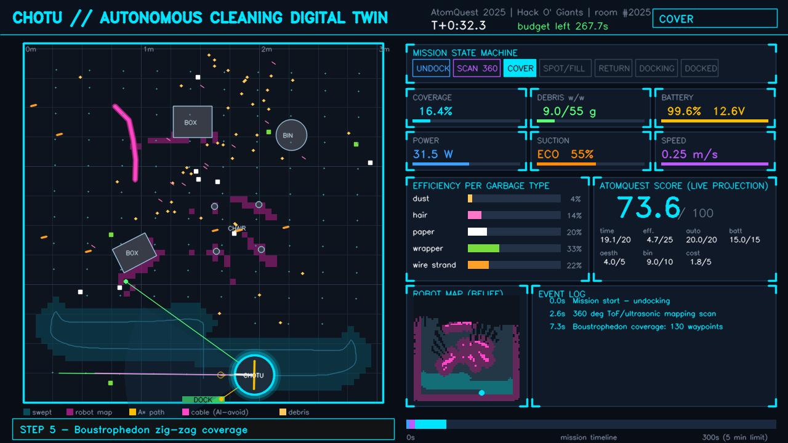
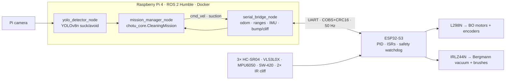
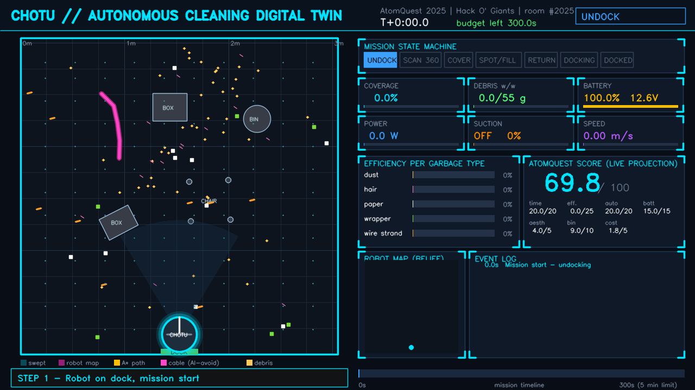
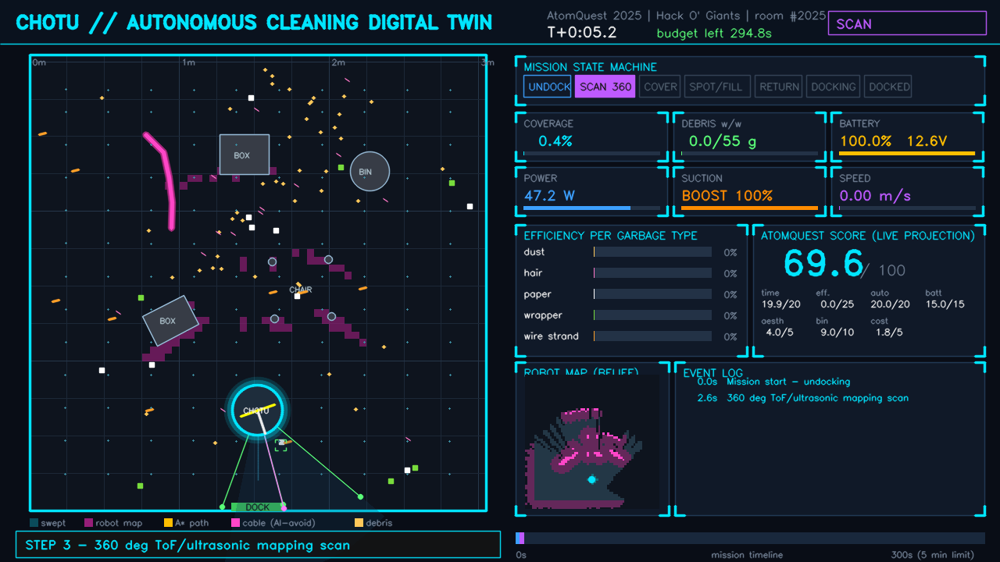
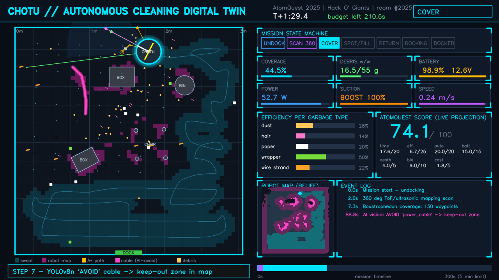
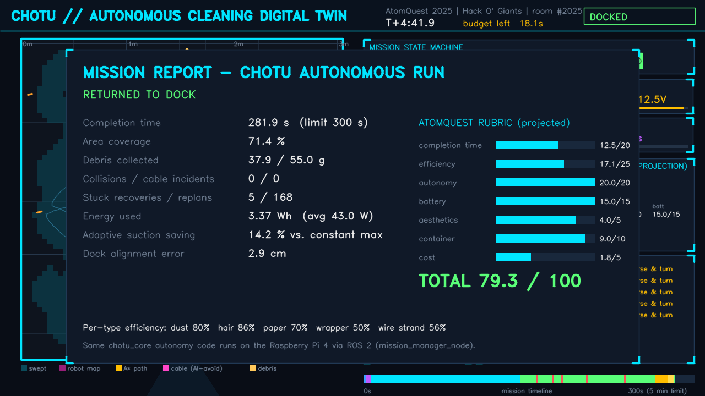
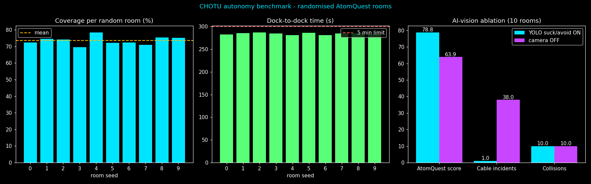
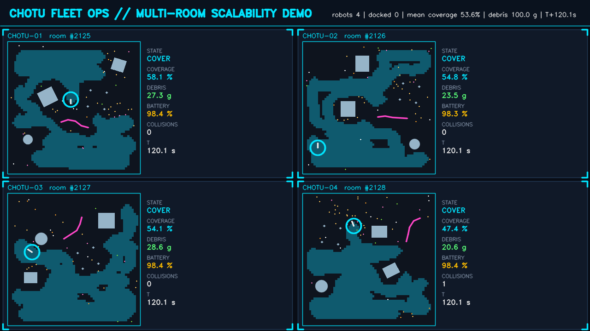

# CHOTU: Compact Home Operations & Tidying Unit

**An autonomous floor-cleaning robot. 🏆 People's Choice Award and Top 10 finalist at AtomQuest 2025 (Atomberg).**

[](https://github.com/Gurjas2112/CHOTU/actions/workflows/ci.yml)


CHOTU started as Team **Hack O' Giants**' entry to **AtomQuest 2025 – The Ultimate Tech Competition** by **Atomberg**. The brief was a robot that cleans a randomised challenge room (dust, paper, hair, wrappers and wire strands among unknown obstacles) in **5 minutes** and **returns to its dock**. The December 2025 prototype was a reactive bump-and-turn bot that won the **People's Choice Award** at the Grand Finale.

**v2 (this repository) makes it truly autonomous:**
* Hybrid **Raspberry Pi 4 (ROS 2) + ESP32-S3 (real-time)** architecture
* Online mapping with **boustrophedon coverage**, **A\*** detours and a time-aware **return-to-dock**
* **YOLOv8n "suck / avoid" vision** (based on the VLM-Vac paper)
* Adaptive suction
* A **digital twin** that runs the *same* autonomy code as the robot
* Full documentation for setup, configuration, testing and deployment

<p align="center">
  
</p>

---

## Table of contents
1. [Highlights](#1-highlights)
2. [Achievements](#2-achievements)
3. [The problem](#3-the-problem-atomquest-2025)
4. [System architecture](#4-system-architecture)
5. [Autonomy stack](#5-autonomy-stack)
6. [Simulation and results](#6-simulation-and-results)
7. [Repository structure](#7-repository-structure)
8. [Quick start](#8-quick-start)
9. [Documentation](#9-documentation)
10. [Tech stack and skills](#10-tech-stack-and-skills-demonstrated)
11. [Team and acknowledgements](#11-team-and-acknowledgements)

---

## 1. Highlights

| | |
|---|---|
| 🧠 **Single source of autonomy** | `chotu_core` (pure Python + numpy) is imported by the ROS 2 node *and* the simulator. Every simulated room tests the robot code. |
| 🗺️ **Mapping + coverage** | Log-odds occupancy grid from 3× HC-SR04 (cone-aware) + VL53L0X ToF. Lane-biased boustrophedon, A\* detours, frontier fill. |
| 🏠 **Finale-rule aware** | Starts on the dock, replans its home ETA every second and leaves with a safety margin. Docks within ~3 cm (IR beacon). |
| 👁️ **Suck / avoid AI vision** | YOLOv8n classes split into *vacuum it* (boost suction, spot clean) and *avoid it* (cables, socks, liquids become map keep-outs). Cable incidents drop from 38 to 1 over 10 rooms. |
| ⚡ **Real-time safety on the MCU** | ESP32-S3 runs 50 Hz wheel PID and a 300 ms watchdog. Bump, cliff and ToF stops work even if Linux hangs. |
| 🔌 **Shared wire protocol** | COBS + CRC16 frames, tested against the same byte vectors in Python (pytest) and C++ (g++, 322 checks). |
| 🐳 **Production-style DevOps** | Multi-stage versioned Docker images (dev / runtime / perception / twin), compose profiles, dev container, arm64 buildx, GitHub Actions CI. |
| 🚀 **Futuristic, scalable twin** | Neon mission-control HUD, 4-robot fleet dashboard, randomised-room benchmarks, AI ablation charts, all recorded to MP4. |

## 2. Achievements

<p align="center">
  
  
</p>

* 🏆 **People's Choice Award**: audience-favourite innovation at the AtomQuest 2025 Grand Finale
* 🎖️ **Top 10 finalist** (Certificate of Achievement from Atomberg's CEO and COO, plus a medal)
* 🧑‍🏫 **Mentorship** from Atomberg industry experts and from Dr. Tejas Pramod Naik (COEP Tech)
* 📜 **Certificates** for creativity, teamwork and technical excellence
* 🏭 **AIC tour** of Atomberg's Innovation Center, meeting the leadership team including the CEO

> *"Excited to share that our team Hack O' Giants delivered a remarkable performance at AtomQuest 2025 – The Ultimate Tech Competition, organized by Atomberg … People's Choice Award for the audience-favorite innovation … Mentorship from industry experts … Certificates acknowledging our creativity, teamwork, and technical excellence … AIC Tour – an insightful visit to Atomberg's Innovation Center."*
> — Gurjas Singh Gandhi on LinkedIn. The full post and all photos are in [`essential_docs/ACHIEVEMENTS.md`](essential_docs/ACHIEVEMENTS.md).

## 3. The problem (AtomQuest 2025)

| Rule (Round 3 brief) | How CHOTU v2 handles it |
|---|---|
| Room shape known in advance, obstacle and garbage placement random | Walls are an analytic band. Obstacles are mapped online. |
| Start from and **return to the docking station**, or the attempt is incomplete | Mission FSM with A\* return, IR-beacon docking |
| **5-minute** session, restarts cost time | Time-budget-aware return. Stuck recovery avoids manual restarts. |
| Score: time 20 · efficiency per garbage type 25 · autonomy and avoidance 20 · battery 15 · container 10 · aesthetics 5 · cost 5 | `chotu_core/scoring.py` computes a live projection of this rubric |
| Max 1.5 ft × 1.5 ft × 1 ft | Ø 34 cm × 22 cm |

## 4. System architecture



The full details (pin map, protocol table, ROS graph, FSM) are in [`essential_docs/ARCHITECTURE.md`](essential_docs/ARCHITECTURE.md).

## 5. Autonomy stack

```
UNDOCK ─► SCAN 360° ─► COVER (boustrophedon) ─► SPOT CLEAN / FRONTIER FILL ─► RETURN (A*) ─► DOCKING ─► DOCKED
                │                │                                ▲
                └──► STUCK RECOVERY (reverse + VFH escape) ───────┘      time / battery watchdog at every tick
```

| Module | Technique |
|---|---|
| `kinematics.py` | Diff-drive model, encoder + MPU6050 complementary-filter odometry |
| `occupancy_grid.py` | 5 cm log-odds grid, 15° ultrasonic cone, wall-echo rejection, camera keep-out zones |
| `coverage_planner.py` | Serpentine lanes (22 cm spacing for a 24 cm head), coverage tracker, connected-component frontier pockets |
| `path_planner.py` | 8-connected A\* on a hard/soft two-tier map with an escape disc, string-pulling |
| `obstacle_avoidance.py` | Echo-to-corridor projection for a round chassis (side walls do not stop it, chair legs ahead do) |
| `mission_fsm.py` | Explicit transition table. Illegal transitions raise errors and are tested. |
| `suction_controller.py` | ECO 55 % / BOOST 100 % on debris ahead (fan power ∝ duty^1.5) |
| `perception.py` | YOLOv8n adapter, pinhole floor projection, mock detector for the sim |
| `protocol.py` | COBS + CRC16-CCITT framing mirrored in the firmware |
| `scoring.py` | AtomQuest rubric (weights from the official brief) |

## 6. Simulation and results

`bot_simulation/` is a physics and sensor digital twin. It models noisy sonar cones, ToF, gyro bias, wheel slip, collisions, garbage pick-up probability per type, energy use and a 5 FPS camera. It drives the **real** `CleaningMission`.

| Flow | |
|---|---|
|  |  |
| 1. Docked, mission start | 2. 360° ToF/ultrasonic mapping scan |
|  |  |
| 3. YOLO *avoid* → cable keep-out zone | 4. Mission report and AtomQuest rubric |

**All 13 flow-wise screenshots, the full-length real-time recording (`chotu_full_mission_recording.mp4`) and the 4-robot fleet time-lapse are in [`bot_simulation/simulation_screenshot_screen_recording/`](bot_simulation/simulation_screenshot_screen_recording/).**

**Benchmark: 10 randomised rooms with noise on (`record_demo.py`)**

| Metric | AI vision ON | Camera OFF |
|---|---|---|
| Returned to dock within 5 min | **10 / 10** | 10 / 10 |
| Mean coverage of reachable floor | 73.5 % | 79.2 % |
| Mean debris collected (w/w): dust · hair · paper · wrapper · wire | **80 · 73 · 74 · 68 · 75 %** | 65 · 58 · 55 · 45 · 50 % |
| Cable incidents (brush tangles) | **1** | 38 |
| Mean projected AtomQuest score | **78.8** | 63.9 |

The camera trades about 6 points of raw area coverage, spent avoiding cables and detouring to debris, for much higher pick-up by mass and almost no cable tangles. Mass pick-up is what the AtomQuest efficiency criterion scores.

**Robustness, 40 more random rooms** (`benchmark_40_rooms.json`): **40 / 40 docked**, 39 / 40 inside 300 s (one at 308.9 s), mean coverage 70.0 %, 1.15 light collisions per run, 2 cable incidents in total, and a mean projected score of 77.6.

<p align="center"></p>
<p align="center"></p>

> These are simulator results; the physical v2 robot has not been built yet. `essential_docs/TESTING.md` defines the hardware-in-the-loop and on-floor acceptance tests that will calibrate the twin against the real robot.

## 7. Repository structure

```
CHOTU/
├── chotu_core/                    # shared autonomy library (ROS 2 + simulator)
├── bot_simulation/
│   ├── chotu_sim/                 # world generator, physics/sensors, HUD + fleet renderer, video
│   ├── run_simulation.py          # live / headless / benchmark / fleet CLI
│   ├── record_demo.py             # screenshots + MP4s + charts + metrics
│   └── simulation_screenshot_screen_recording/
├── firmware/esp32s3_base_controller/
│   ├── platformio.ini  include/{pins.h,config.h}  src/main.cpp
│   ├── lib/chotu_logic/src/chotu_logic.h      # protocol, PID, safety (host-testable)
│   └── test_host/                              # g++ unit tests (322 checks)
├── ros2_ws/src/
│   ├── chotu_interfaces/   chotu_description/   chotu_base/
│   ├── chotu_navigation/   chotu_perception/    chotu_bringup/   chotu_gazebo/
├── docker/                        # multi-stage Dockerfile, compose profiles, CycloneDDS, twin image
├── .devcontainer/                 # VS Code dev container (ROS 2 Humble)
├── scripts/                       # setup_windows.ps1, setup_wsl_ros2_humble.sh, flash, deploy, run_sim
├── tests/                         # pytest: unit + end-to-end missions
├── models/                        # trained YOLO weights (not committed)
├── .github/workflows/ci.yml       # pytest, host tests, PlatformIO build, colcon build
└── essential_docs/                # competition documents + project documentation (below)
```

## 8. Quick start

```powershell
# Windows 11: digital twin + all tests (Python 3.12)
powershell -ExecutionPolicy Bypass -File scripts\setup_windows.ps1
python bot_simulation\run_simulation.py               # live HUD
python bot_simulation\run_simulation.py --fleet 4     # fleet dashboard
python bot_simulation\record_demo.py                  # regenerate screenshots + recordings
```
```bash
# ROS 2 Humble + Gazebo in Docker (nothing installed on the host)
docker compose -f docker/docker-compose.yml --profile dev build
docker compose -f docker/docker-compose.yml --profile sim up
# Robot (Raspberry Pi 4)
bash scripts/flash_esp32.sh && REGISTRY=ghcr.io/<you> PI_HOST=ubuntu@chotu.local bash scripts/deploy_pi.sh 2.0.0
```

## 9. Documentation

| Doc | Contents |
|---|---|
| [PROJECT_ANALYSIS.md](essential_docs/PROJECT_ANALYSIS.md) | Review of every competition document, v1 to v2 gap analysis, mentor feedback mapping |
| [ARCHITECTURE.md](essential_docs/ARCHITECTURE.md) | Block diagram, FSM, algorithms, protocol, ESP32 pin map, ROS graph |
| [HARDWARE_SOFTWARE_REQUIREMENTS.md](essential_docs/HARDWARE_SOFTWARE_REQUIREMENTS.md) | ₹11,480 itemised BOM, special parts, wiring and power domains, software versions |
| [PROTOTYPE_SPEC.md](essential_docs/PROTOTYPE_SPEC.md) | Updated spec sheet plus the development workstation spec |
| [SETUP.md](essential_docs/SETUP.md) | Digital twin, ROS 2 (Docker / WSL), robot bring-up |
| [CONFIGURATION.md](essential_docs/CONFIGURATION.md) | Every tunable parameter, PID tuning, perception, DDS |
| [TESTING.md](essential_docs/TESTING.md) | L1–L6 test pyramid, HIL bench, acceptance run, CI |
| [DEPLOYMENT.md](essential_docs/DEPLOYMENT.md) | Versioned images, arm64 buildx, Pi deploy, rollback, competition checklist |
| [ACHIEVEMENTS.md](essential_docs/ACHIEVEMENTS.md) | Awards, LinkedIn post, photos, competition journey |

## 10. Tech stack and skills demonstrated

**Robotics:** ROS 2 Humble (rclpy, custom msgs/srv, launch, TF2, ros_gz), Gazebo Fortress, URDF/xacro, occupancy-grid mapping, A\*, coverage path planning, differential-drive kinematics, sensor fusion, finite-state machines.
**Embedded:** ESP32-S3 (Arduino / PlatformIO), ISRs, LEDC PWM, PID control, I²C drivers (VL53L0X, MPU6050), binary protocols (COBS, CRC16), watchdog-based safety.
**AI / CV:** YOLOv8n fine-tuning (Ultralytics, CUDA on an RTX 3060), NCNN export for the Pi, camera ground-plane projection, VLM-Vac suck/avoid design.
**Software engineering:** Python, C++17, pytest, g++ host testing, cross-language test vectors, Docker multi-stage and buildx, Compose, dev containers, GitHub Actions, OpenCV visualisation, matplotlib benchmarking.

## 11. Team and acknowledgements

**Team Hack O' Giants**, PES Modern College of Engineering, Pune: **Gurjas Singh Gandhi**, Joy Johnson Kujur, Sumedh Khedekar, Prathamesh Lohar, Dipali Gode (SY MCA), and Swapnil Kulkarni (Mechanical).

Thanks to **Dr. Tejas Pramod Naik** (COEP Technological University) for mentoring, to the **Atomberg** mentors and leadership team for AtomQuest 2025, and to our teachers at PES MCOE.

References: Win & Kyaw, *Autonomous Floor Cleaning Robot with Infrared and Ultrasonic* (IJISRT 2018); CesNieto, *DIY Vacuum Robot* (Instructables); Mirjalili et al., *VLM-Vac: Enhancing Smart Vacuums through VLM Knowledge Distillation and Language-Guided Experience Replay* (arXiv:2409.14096); R. Ramachandran, *The Complete Guide to Docker for ROS 2 (2026 Edition)*.

Licensed under the [MIT License](LICENSE).
