# CHOTU: Compact Home Operations & Tidying Unit

**An autonomous floor-cleaning robot, from competition prototype to a full-stack engineering system.**
🏆 *People's Choice Award and Top 10 finalist, AtomQuest 2025 (Atomberg Technologies).*

[](https://github.com/Gurjas2112/CHOTU/actions/workflows/ci.yml)


> **Project status.** v3 is a **prototype on demo data**. The AtomQuest robot was built and demonstrated in December 2025. The v3 hardware (a Pi 4 + ESP32-S3 hybrid with a carrier PCB and a printed body) is fully designed but **not yet bought or assembled**. Every v3 result below comes from simulation or from software running against demo data, and each one says which.

<p align="center">
  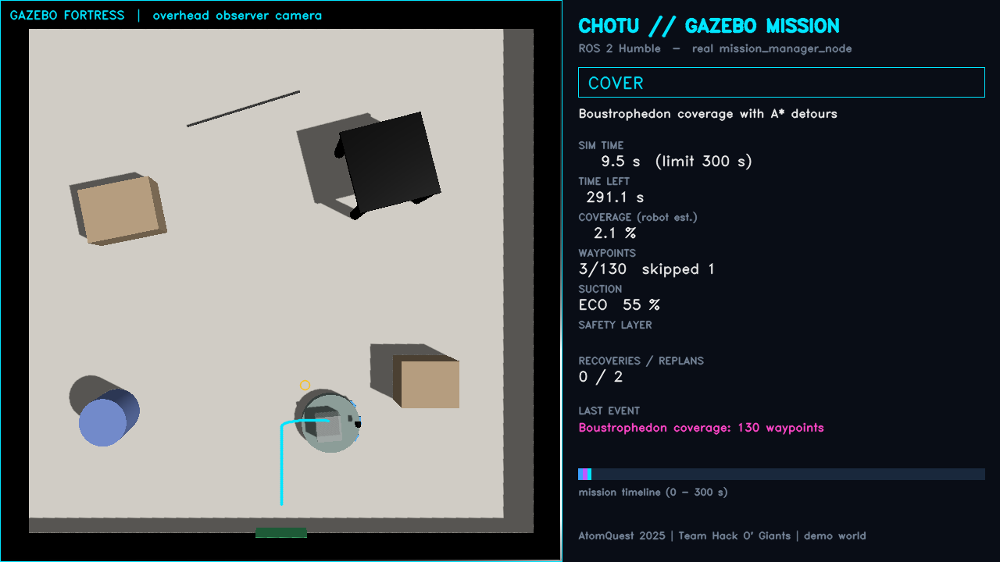
  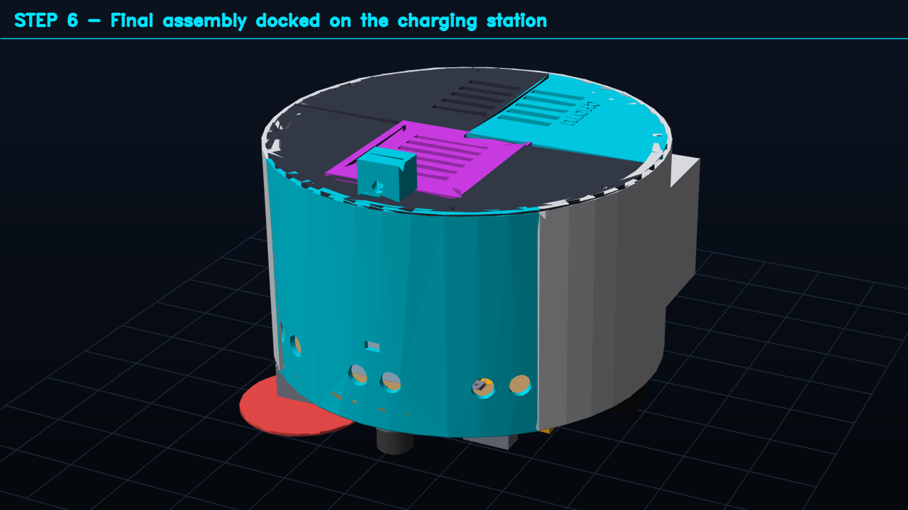
</p>

---

## Contents
1. [For recruiters: skills and evidence](#1-for-recruiters-skills-and-evidence)
2. [Results in numbers](#2-results-in-numbers)
3. [Demo gallery](#3-demo-gallery)
4. [Achievements](#4-achievements)
5. [System architecture](#5-system-architecture)
6. [Engineering decisions](#6-engineering-decisions)
7. [Repository structure](#7-repository-structure)
8. [Quick start](#8-quick-start)
9. [Quality: tests and CI](#9-quality-tests-and-ci)
10. [Documentation](#10-documentation)
11. [Team and acknowledgements](#11-team-and-acknowledgements)

---

## 1. For recruiters: skills and evidence

The repository covers the whole product: firmware, robotics software, simulation, mobile app, backend, PCB and mechanical design. Each row points to working code and the test that checks it.

| Role / skill area | What was built | Where to look |
|---|---|---|
| **Robotics software (ROS 2)** | Mission state machine, log-odds occupancy mapping, boustrophedon coverage, A* on a two-tier cost map, time-aware return to dock, no-go zones, operator dock command | [`chotu_core/`](chotu_core/), [`ros2_ws/`](ros2_ws/) |
| **Simulation** | Full ROS 2 stack in Gazebo Fortress, headless in Docker. IMU-fused odometry. Overhead-camera mission recorder. | [`bot_simulation/`](bot_simulation/) |
| **Embedded (ESP32-S3)** | 50 Hz wheel PID, ISR encoders, safety supervisor with a 300 ms watchdog, TB6612 STBY hardware cut, COBS + CRC16 binary protocol | [`firmware/`](firmware/), 322 host tests |
| **Electronics / PCB** | Carrier board generated from code (SKiDL → KiCad netlist, 54 parts, 45 nets), six schematic sheets, design-rule check, Protoflow/JLCPCB hand-off | [`hardware/pcb/`](hardware/pcb/) |
| **Mechanical CAD / DFM** | 28-part parametric CadQuery body with an automatic FDM review (watertight, bed fit, overhangs, bridges), STEP/STL/DXF, assembly video | [`bot_3d_printing/`](bot_3d_printing/) |
| **Mobile (Flutter)** | Robot control app: live map, no-go zone drawing, schedules, alerts, mission reports; rosbridge and REST clients | [`mobile_app/`](mobile_app/) |
| **Backend (Python)** | FastAPI fleet API, REST + versioned WebSocket protocol, repository pattern (sample JSON ↔ PostgreSQL), rosbridge client with reconnect, OpenAPI docs, dashboard | [`backend/`](backend/) |
| **AI / computer vision** | YOLOv8n "suck / avoid" classes from the VLM-Vac paper; detections become map keep-outs or trigger suction BOOST | [`chotu_core/perception.py`](chotu_core/perception.py), [`ros2_ws/src/chotu_perception`](ros2_ws/src/chotu_perception) |
| **DevOps** | Multi-stage versioned Docker images, compose profiles, dev container, arm64 deploy script, GitHub Actions running 5 jobs | [`docker/`](docker/), [`.github/workflows/ci.yml`](.github/workflows/ci.yml) |
| **Engineering judgement** | Cost and sustainability review with cited sources: reuse vs buy, motor and MOSFET selection, what *not* to build (VLM, agent layer) | [`docs/ATOMBERG_ENGINEERING_REVIEW.md`](docs/ATOMBERG_ENGINEERING_REVIEW.md) |

## 2. Results in numbers

| Metric | Value | Source |
|---|---|---|
| Gazebo mission, full ROS 2 stack | **Docked at 226.5 s** of a 300 s budget, **97.9 %** coverage estimate, **0** stuck recoveries | [`gazebo_mission_metrics.json`](bot_simulation/gazebo_recording/gazebo_mission_metrics.json) |
| Randomised rooms, v2 benchmark | **40/40 docked**, mean projected AtomQuest score **77.6 / 100** | v2 digital twin (commit `9757b23`), served as sample data by [`backend/`](backend/) |
| AI-vision ablation, 10 rooms | Cable tangles **38 → 1**; score **63.9 → 78.8** | v2 digital twin |
| Energy | Adaptive suction saves **11–20 %**; ≈ 3.4 Wh per 5-minute mission | v2 digital twin |
| Printed body | **28/28** parts pass the automatic FDM review; ≈ 1 kg PETG, ≈ 92 h | [`review_report.md`](bot_3d_printing/review_report.md) |
| Carrier PCB | **0** design-rule errors; every GPIO matches the firmware, checked in CI | [`erc_report.txt`](hardware/pcb/erc_report.txt), [`test_pcb_netlist.py`](tests/test_pcb_netlist.py) |
| Bill of materials | **₹13,693** total, of which ₹3,694 is reused from the competition build | [`docs/HARDWARE_SOFTWARE_REQUIREMENTS.md`](docs/HARDWARE_SOFTWARE_REQUIREMENTS.md) |
| Automated checks | **388** tests: 32 core/PCB + 23 backend + 11 Flutter + 322 firmware | [§9](#9-quality-tests-and-ci) |

## 3. Demo gallery

All media below comes from demo data or simulation.

### Gazebo simulation: full mission, ROS 2 stack
[▶ `chotu_gazebo_full_mission.mp4`](bot_simulation/gazebo_recording/chotu_gazebo_full_mission.mp4) (229.7 s, real-time)

| Undock | Coverage | Return (A*) | Docked |
|---|---|---|---|
| 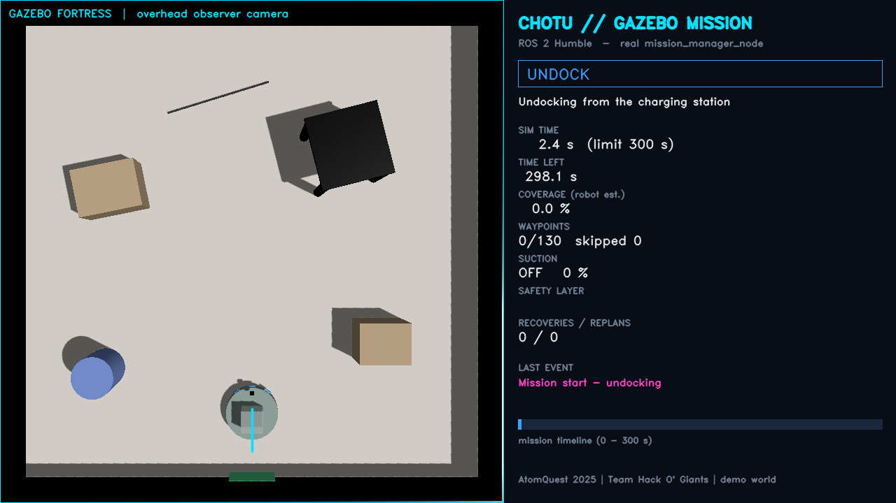 |  | 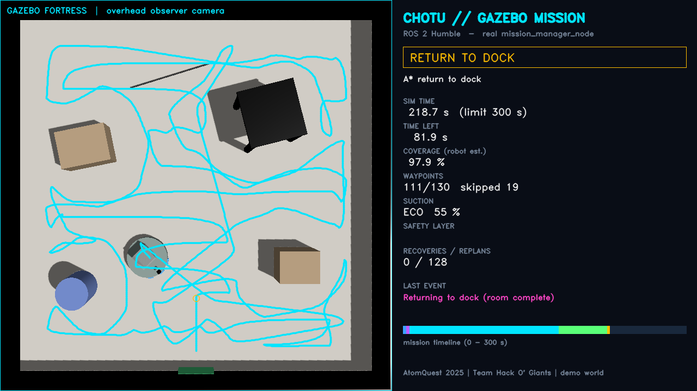 | 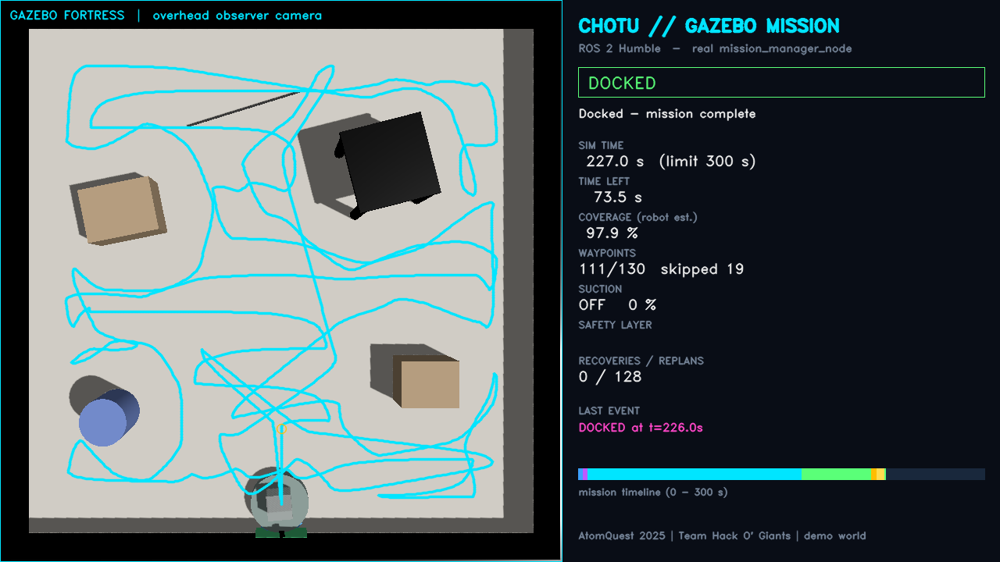 |

### Mobile app (Flutter, demo robot)
[▶ `chotu_app_full_demo.mp4`](mobile_app/app_screenshot_screen_recording/chotu_app_full_demo.mp4) (64 s). All 17 flow screenshots are in [`mobile_app/app_screenshot_screen_recording/`](mobile_app/app_screenshot_screen_recording/).

<p align="center">
  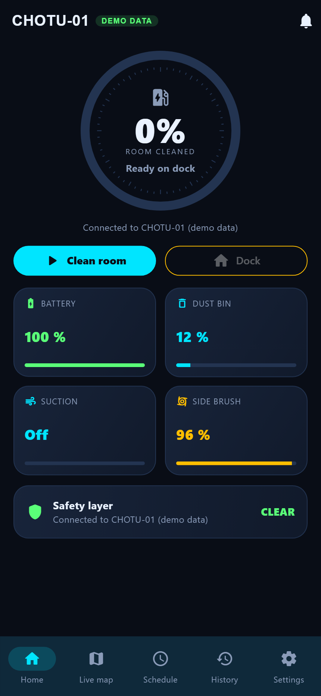
  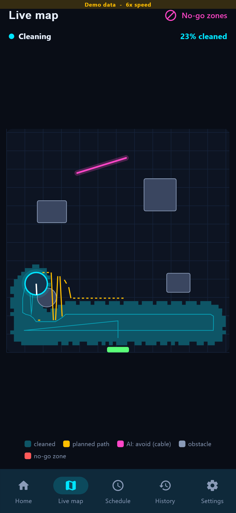
  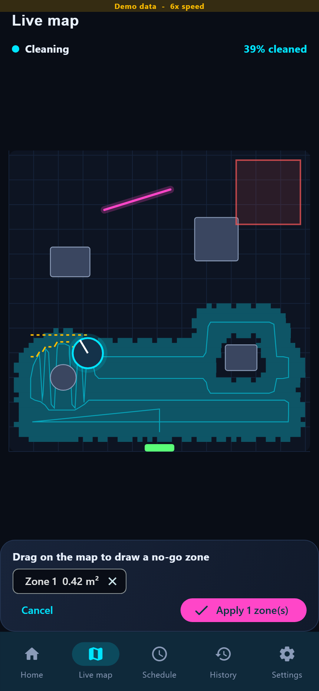
  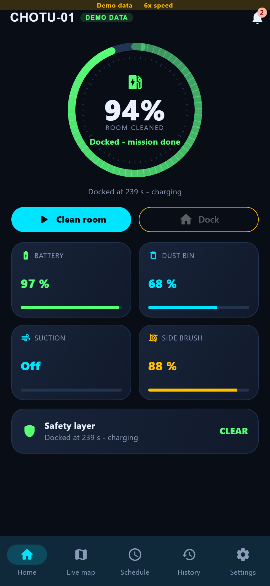
  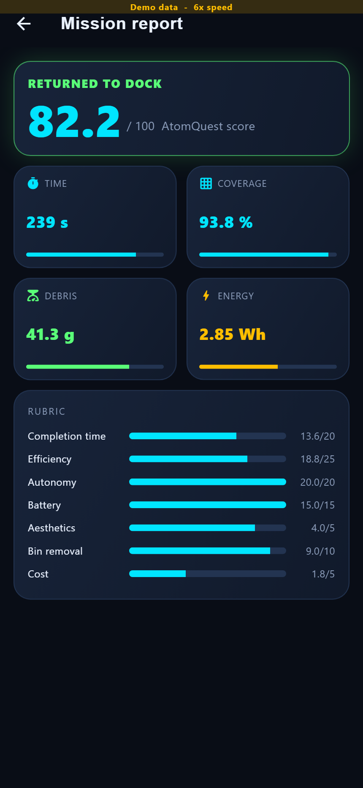
</p>

### 3D-printable body (CadQuery)
[▶ `chotu_v3_cad_walkthrough.mp4`](bot_3d_printing/video/chotu_v3_cad_walkthrough.mp4) (14 s)

| Phase 2: features | Exploded assembly | Print plates (220 mm bed) |
|---|---|---|
| 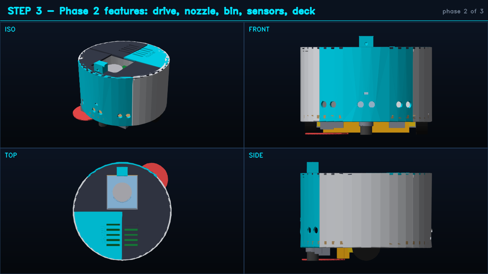 | 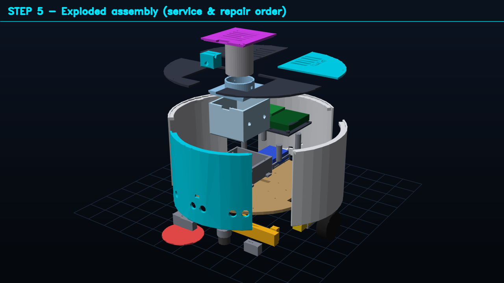 | 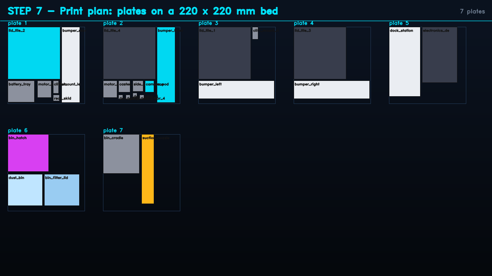 |

### Carrier PCB and fleet backend

| Firmware connection schematic | Fleet dashboard (backend, sample data) |
|---|---|
|  |  |

## 4. Achievements

<p align="center">
  
  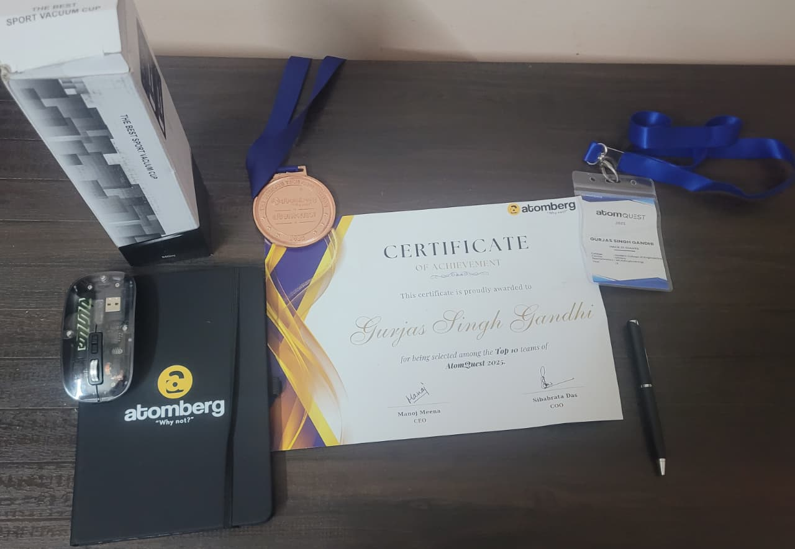
</p>

* 🏆 **People's Choice Award**: the audience-favourite innovation at the AtomQuest 2025 Grand Finale, held at Atomberg's Innovation Center
* 🎖️ **Top 10 finalist**: Certificate of Achievement from Atomberg's CEO and COO, plus a medal
* 🧑‍🏫 **Mentorship** from Atomberg engineers and from Dr. Tejas Pramod Naik (COEP Technological University)

The full story, the LinkedIn post and the photos are in [`docs/ACHIEVEMENTS.md`](docs/ACHIEVEMENTS.md).

## 5. System architecture

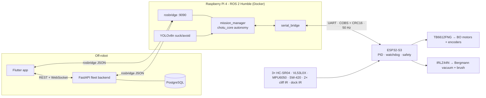

* **All autonomy runs on the robot.** The app and the backend are clients, so a mission finishes and the robot docks even with WiFi down.
* **One autonomy codebase.** `chotu_core` runs in the ROS 2 node, both on the robot and in Gazebo. `gz_sensor_adapter_node` publishes the same topics as the hardware bridge.
* **Specs:** [`docs/ARCHITECTURE.md`](docs/ARCHITECTURE.md) (pin map, FSM, algorithms) and [`backend/PROTOCOL.md`](backend/PROTOCOL.md) (every link, from app to MCU).

## 6. Engineering decisions

One design, chosen against the AtomQuest rubric; [the review](docs/ATOMBERG_ENGINEERING_REVIEW.md) gives the evidence and 19 references.

| Decision | Why |
|---|---|
| Keep the owned **Bergmann BAV-60** (≈ 6.5 kPa) | A 7530 blower gives 35–400 Pa, 16–180× too weak; a WPV40 is an air pump, not a vacuum fan |
| **TB6612FNG** replaces the L298N | ~0.5 V drop instead of ~2 V, a STBY safety cut, the same ₹ |
| **IRLZ44N** replaces the IRF520 | The IRF520 cannot switch 5 A from 3.3 V logic |
| **Pi 4 + ESP32-S3** hybrid | Linux for ROS 2 and vision; an MCU for hard real-time control and the safety watchdog |
| **No VLM, no agent layer** | They earn no rubric points and add latency, cost and an internet dependency. VLM knowledge is distilled into YOLOv8n offline instead. |
| **Carrier PCB generated from code** | Replaces the loose jumper wiring of v1, and a test keeps it equal to the firmware pin map |

## 7. Repository structure

```
CHOTU/
├── chotu_core/            shared autonomy library: FSM, mapping, coverage, A*, protocol, scoring
├── firmware/              ESP32-S3 base controller (PlatformIO) + g++ host tests
├── ros2_ws/src/           ROS 2 packages: interfaces, description, base, navigation, perception, bringup, gazebo
├── bot_simulation/        Gazebo Fortress mission recording (screenshots, video, metrics)
├── mobile_app/            Flutter app, recorder tool, app screenshots and full recording
├── backend/               FastAPI fleet API, sample data, PostgreSQL migration, tests, protocol spec
├── hardware/pcb/          carrier PCB: SKiDL source, KiCad netlist, schematic sheets, Protoflow hand-off
├── bot_3d_printing/       CadQuery model, STL/STEP/DXF, design review, flow PNGs, walkthrough video
├── docker/                multi-stage ROS 2 images and compose profiles (dev / sim / robot / gpu)
├── docs/                  architecture, requirements and BOM, setup, configuration, testing, deployment, review
├── old_essential_docs/        original AtomQuest 2025 material: problem statement, spec sheet, bills, photos, papers
├── models/                where the trained YOLO weights go (not committed)
├── scripts/               Windows setup, WSL ROS install, ESP32 flash, Pi deploy
├── tests/                 pytest: protocol, kinematics, mapping/planning, behaviour, PCB ↔ firmware
└── .github/workflows/     CI: core + PCB, backend, Flutter, firmware, ROS 2
```

## 8. Quick start

```bash
git clone https://github.com/Gurjas2112/CHOTU.git && cd CHOTU

# Core library + tests
pip install -r requirements.txt && pip install -e . && python -m pytest tests -q

# Fleet backend on sample data → http://127.0.0.1:8000 (dashboard), /docs (API)
pip install -r backend/requirements.txt && cd backend && uvicorn chotu_api.main:app

# Mobile app with the demo robot
cd mobile_app/chotu_app && flutter pub get && flutter run -d chrome

# Gazebo: the full ROS 2 mission, headless, recorded to bot_simulation/gazebo_recording/
docker build -f docker/Dockerfile --target dev -t chotu/dev:3.0.0 .
MSYS_NO_PATHCONV=1 docker run --rm -v "$(pwd -W 2>/dev/null || pwd)":/workspace chotu/dev:3.0.0 \
    bash /workspace/bot_simulation/gazebo_recording/run_gazebo_recording.sh

# CAD and PCB generators
pip install -r requirements-dev.txt
python bot_3d_printing/tools/cad_pipeline.py && python hardware/pcb/chotu_carrier.py
```

[`docs/SETUP.md`](docs/SETUP.md) covers every track, including flashing the ESP32 and deploying to the Pi.

## 9. Quality: tests and CI

| Suite | Count | Command |
|---|---|---|
| Core autonomy, protocol, planning, behaviour, PCB ↔ firmware | 32 | `python -m pytest tests -q` |
| Fleet backend (sample + SQL stores, WebSocket, auth, migration, rosbridge link) | 23 | `python -m pytest backend/tests -q` |
| Flutter (rosbridge + backend clients, widget flows) | 11 | `flutter analyze && flutter test` |
| Firmware logic (COBS/CRC16 vectors shared with Python, PID, safety) | 322 | `make -C firmware/esp32s3_base_controller/test_host` |
| PostgreSQL path, end to end | – | `CHOTU_STORE=sql docker compose -f backend/docker-compose.yml --profile db up` (verified locally) |
| Gazebo mission | 1 run | `bot_simulation/gazebo_recording/run_gazebo_recording.sh` (verified locally) |

The CI runs five jobs on every push: core + PCB, backend, Flutter, the firmware host tests with a PlatformIO cross-compile, and the ROS 2 colcon build and test.

## 10. Documentation

| Doc | Contents |
|---|---|
| [ATOMBERG_ENGINEERING_REVIEW.md](docs/ATOMBERG_ENGINEERING_REVIEW.md) | What is needed and what is not, with cited sources |
| [ARCHITECTURE.md](docs/ARCHITECTURE.md) | Block diagram, FSM, algorithms, UART protocol, pin map, ROS graph, end-to-end protocols |
| [HARDWARE_SOFTWARE_REQUIREMENTS.md](docs/HARDWARE_SOFTWARE_REQUIREMENTS.md) | Single BOM (reused / to buy, robu.in links, ₹), wiring, software versions |
| [PROTOTYPE_SPEC.md](docs/PROTOTYPE_SPEC.md) | Updated spec sheet and development workstation |
| [SETUP.md](docs/SETUP.md) · [CONFIGURATION.md](docs/CONFIGURATION.md) · [TESTING.md](docs/TESTING.md) · [DEPLOYMENT.md](docs/DEPLOYMENT.md) | Setting up, tuning, verifying and shipping |
| [PROJECT_ANALYSIS.md](docs/PROJECT_ANALYSIS.md) | Review of the competition documents, and the v1 → v2 → v3 gap analysis |
| [backend/README.md](backend/README.md) · [backend/PROTOCOL.md](backend/PROTOCOL.md) | Connecting a database, connecting robots, the wire protocol |
| [hardware/pcb/README.md](hardware/pcb/README.md) · [bot_3d_printing/README.md](bot_3d_printing/README.md) · [mobile_app/README.md](mobile_app/README.md) | PCB, printed body, app |

## 11. Team and acknowledgements

**Team Hack O' Giants**, PES Modern College of Engineering, Pune: **Gurjas Singh Gandhi**, Joy Johnson Kujur, Sumedh Khedekar, Prathamesh Lohar, Dipali Gode (SY MCA), and Swapnil Kulkarni (Mechanical).

Thanks to **Dr. Tejas Pramod Naik** (COEP Technological University) for mentoring, and to the **Atomberg** mentors and leadership team for AtomQuest 2025.

**References:**
* Win & Kyaw, *Autonomous Floor Cleaning Robot with Infrared and Ultrasonic* (IJISRT 2018)
* CesNieto, *DIY Vacuum Robot* (Instructables)
* Mirjalili et al., *VLM-Vac* (arXiv:2409.14096)
* R. Ramachandran, *The Complete Guide to Docker for ROS 2 (2026 Edition)*
* *3D printing with CadQuery and Claude* (Towards AI)

The engineering review lists all 19 cited sources.

Licensed under the [MIT License](LICENSE).
