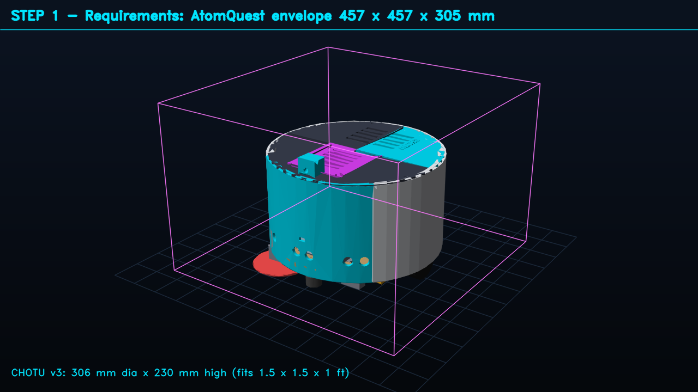
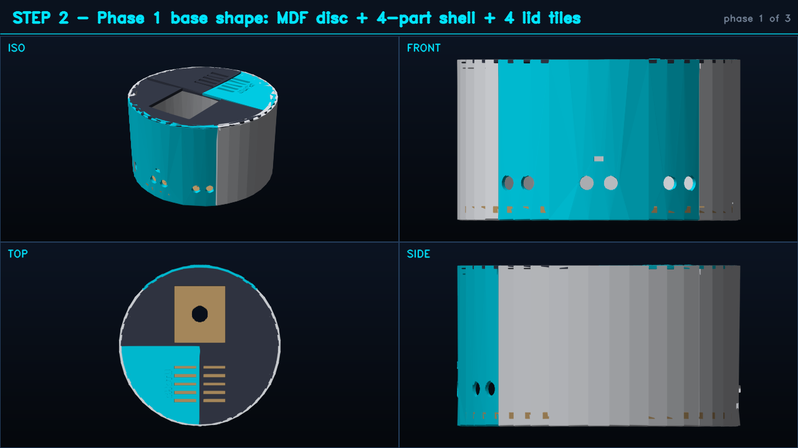
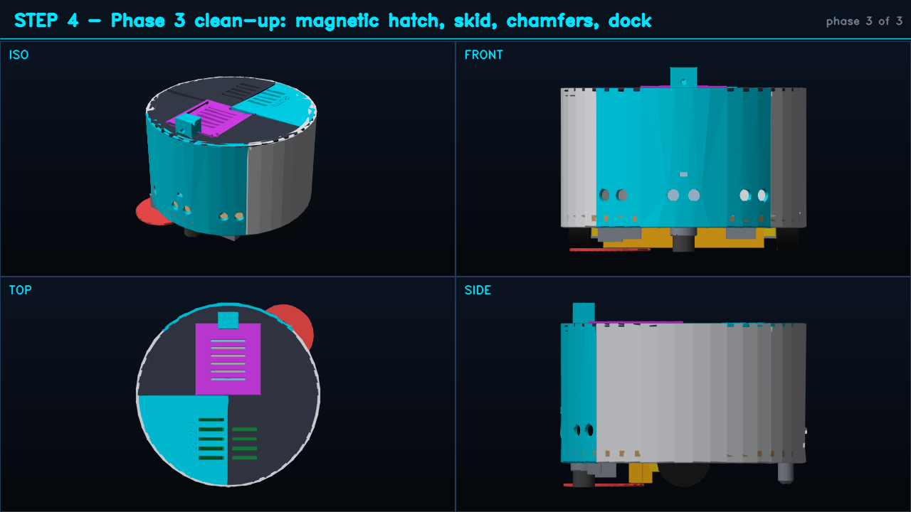

# CHOTU v3: 3D-printable re-engineered body

A parametric CadQuery model of the whole robot body: **28 printed parts**, every one sized for a **220 × 220 mm** bed. It reuses the MDF base from the AtomQuest build, has a magnetic quick-release dust bin, and includes a matching charging dock. One script rebuilds, reviews, exports and renders everything.

<p align="center"></p>

**Walkthrough video:** [`video/chotu_v3_cad_walkthrough.mp4`](video/chotu_v3_cad_walkthrough.mp4) (14 s, 1280×720, H.264). It shows the three build phases, an exploded view, re-assembly and the robot docked.

## Design flow (one PNG per stage)

| | |
|---|---|
|  **1. Requirements.** AtomQuest envelope 457 × 457 × 305 mm; CHOTU is Ø 306 × 230 mm. |  **2. Phase 1, base shape.** MDF disc, 4-segment bumper shell, 4 lid tiles. |
|  **3. Phase 2, features.** Drive brackets, 200 mm nozzle, bin and cradle, sensor windows, electronics deck. |  **4. Phase 3, clean-up.** Magnetic hatch, rear skid, bottom chamfers, dock. |
|  **5. Exploded assembly**, in service and repair order. |  **7. Print plates.** Every part is laid out on 220 mm beds. |

## Folder contents

| Path | What |
|---|---|
| `cad/chotu_v3.py` | The model. Every dimension lives in one parameter table (`P`): bed size, wall thickness, hole clearances, magnet pockets, sensor angles, bin volume. |
| `tools/cad_pipeline.py` | Build → FDM review → export → previews → flow PNGs → video. A lock file prevents two concurrent runs. The MP4 is written aside and published atomically. |
| `stl/` | 28 print-ready STLs |
| `step/` | One STEP per part plus `chotu_v3_assembly.step` (printed + reference parts), for any CAD tool |
| `dxf/mdf_base_template.dxf`, `mdf_base_holes.csv` | Drilling template for the reused MDF base. The holes come from the model. |
| `previews/` | 4-view render of each printed part |
| `review_report.md` | Automatic design review per part: watertight, bed fit, flat bottom, overhangs, bridges, grams and hours |

## Print settings

| Setting | Value |
|---|---|
| Material | **PETG** for the bumper shell, nozzle, bin (clear), bin cradle, motor brackets and dock. **PLA+** (already owned) for deck pillars, lid tiles and cliff mounts. |
| Nozzle / layer | 0.4 mm / 0.2 mm |
| Walls / infill | 3 perimeters, 20 % gyroid (bin: 4 perimeters, 100 % floor for watertightness) |
| Supports | None. The review checks that steep overhangs are only the round sensor holes and that bridges are under 20 mm. |
| Totals | ≈ 1,007 g, ≈ 92 h (`review_report.md`) |
| Hardware | 12 × 10×3 mm N52 magnets (hatch, bin, cradle); M3 screws with brass heat-set inserts |

## Regenerate

```bash
pip install -r requirements-dev.txt          # cadquery 2.8, trimesh, opencv, numpy
python bot_3d_printing/tools/cad_pipeline.py # about 2 min: rebuilds every output in this folder
python bot_3d_printing/tools/cad_pipeline.py --no-video
```

## Attribution

The workflow follows *"3D printing with CadQuery and Claude"* (Towards AI): parametric code, a three-phase build (base shape → features → clean-up), and an automatic printability review before export. It is modelled on the checklist in [flowful-ai/cad-skill](https://github.com/flowful-ai/cad-skill). The renderer is a small numpy/OpenCV painter's-algorithm renderer written for this repo, so it runs headless with no GPU.
