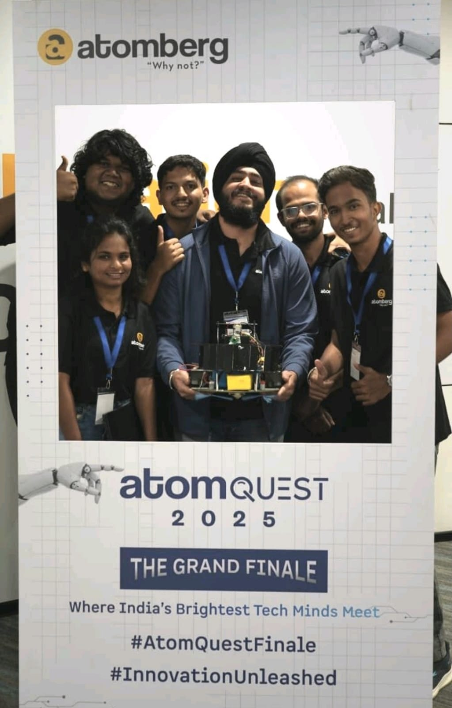
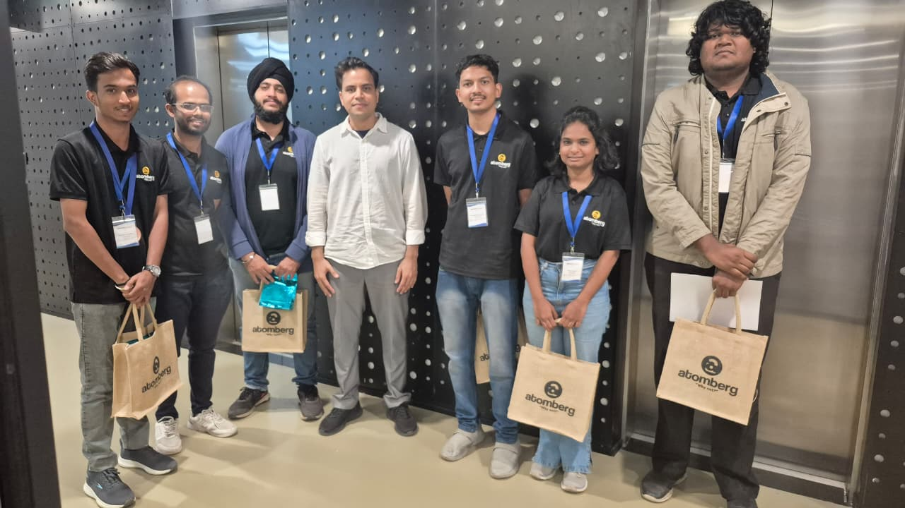
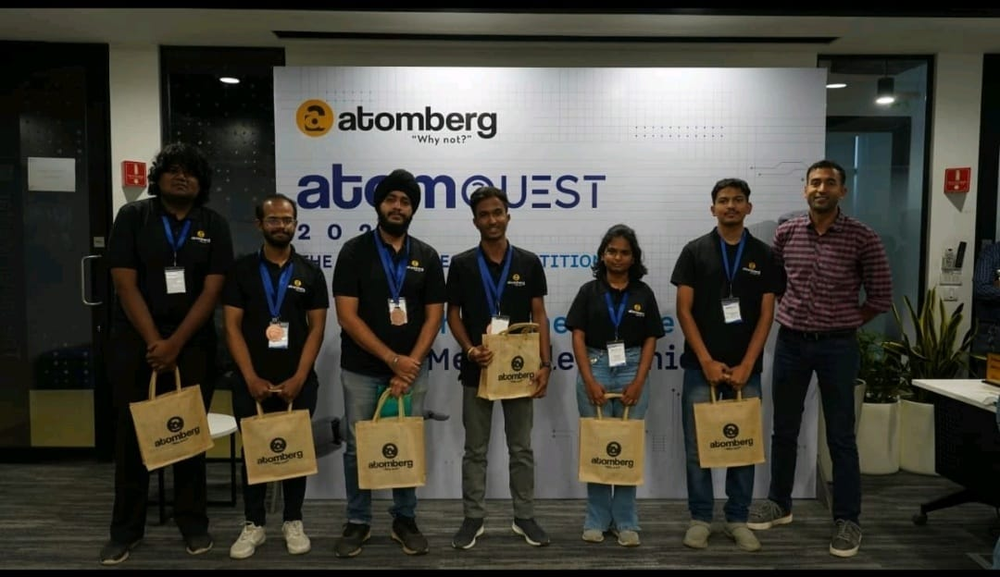

# Achievements: AtomQuest 2025 (Atomberg)

## People's Choice Award, AtomQuest 2025: The Ultimate Tech Competition

Team **Hack O' Giants** (PES Modern College of Engineering, Pune) took **CHOTU** to the **Grand Finale at the Atomberg Innovation Center, Pune**. The team was selected among the **Top 10 teams** in the country.

| Recognition | Details |
|---|---|
| 🏆 **People's Choice Award** | Audience-favourite innovation at the Grand Finale |
| 🎖️ **Top 10 finalist** | Certificate of Achievement "for being selected among the Top 10 teams of AtomQuest 2025", signed by Atomberg's CEO and COO, plus a finalist medal |
| 🧑‍🏫 **Industry mentorship** | Mentorship from Atomberg experts during the development phase, plus faculty and industry guidance from Dr. Tejas Pramod Naik (COEP Tech) |
| 📜 **Certificates** | For creativity, teamwork and technical excellence |
| 🏭 **AIC tour** | Guided visit to Atomberg's Innovation Center and interaction with the Atomberg leadership team, including the CEO |

### LinkedIn post (Gurjas Singh Gandhi)

> excited to share that our team Hack O' Giants delivered a remarkable performance at AtomQuest 2025 – The Ultimate Tech Competition, organized by Atomberg.
>
> We were recognized for our work and walked away with some meaningful achievements:
>
> - People's Choice Award for the audience-favorite innovation
> - Mentorship from industry experts
> - Certificates acknowledging our creativity, teamwork, and technical excellence
> - AIC Tour – an insightful visit to Atomberg's Innovation Center
>
> It was an incredible experience meeting the Atomberg leadership team, including the CEO, and learning from their vision and insights.
>
> I'm genuinely grateful to have worked with such a dedicated and talented team: Sumedh Khedekar, Prathamesh Lohar, JOY Kujur, and Swapnil Kulkarni. Every member contributed immensely, and this achievement is truly a collective effort.
>
> A heartfelt thank you to our teachers and mentors for their continuous guidance and encouragement throughout this journey.
>
> This experience has been truly motivating, and I'm looking forward to building more impactful solutions and exploring new opportunities ahead.

### Photos

| | |
|---|---|
|  |  |
| Certificate of Achievement (Top 10), medal, finalist badge and kit | Team Hack O' Giants with CHOTU at the AtomQuest 2025 Grand Finale |
|  |  |
| At the Atomberg Innovation Center (AIC tour) | Finalists at the AtomQuest 2025 stage |

## Competition journey

| Round | Deliverable | Outcome |
|---|---|---|
| Round 1: Abstract (Aug 2025) | Abstract, block diagram, rough specifications | Qualified |
| Round 2: Proto Level 1 (Sep 2025) | 90 s video, components, mentor consent letter | Qualified |
| Round 3: Proto Level 2 (Oct 2025) | Bot in motion and cleaning video, spec sheet, block diagram, mentor review | **Shortlisted for the finale (Top 10)** |
| Mentorship phase | Sessions with Atomberg mentors | Design and autonomy refinements |
| Round 4: Grand Finale (Nov 2025, AIC Pune) | Live run in a randomised challenge room and pitch to Atomberg leadership | 🏆 **People's Choice Award** |

## Team

| Member | Programme |
|---|---|
| Gurjas Singh Gandhi | SY MCA, PES MCOE |
| Joy Johnson Kujur | SY MCA, PES MCOE |
| Sumedh Khedekar | SY MCA, PES MCOE |
| Prathamesh Lohar | SY MCA, PES MCOE |
| Dipali Gode | SY MCA, PES MCOE |
| Swapnil Kulkarni | Mechanical Engineering, PES MCOE |

Mentor: **Dr. Tejas Pramod Naik**, Assistant Professor, Department of Mechanical Engineering, COEP Technological University.
