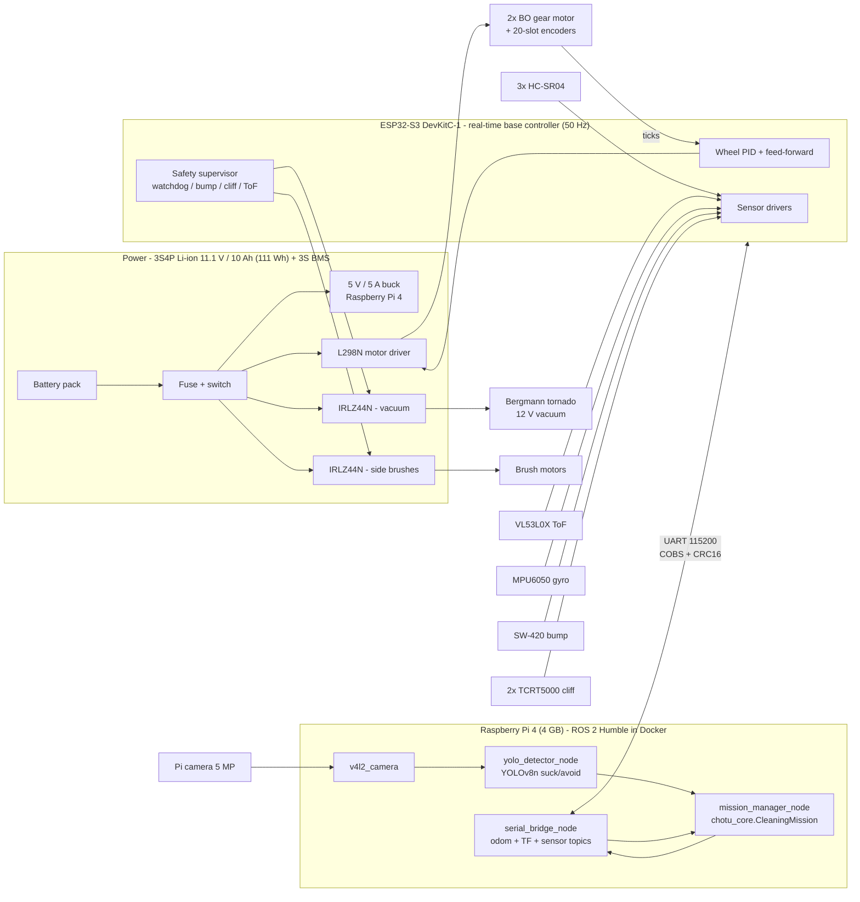
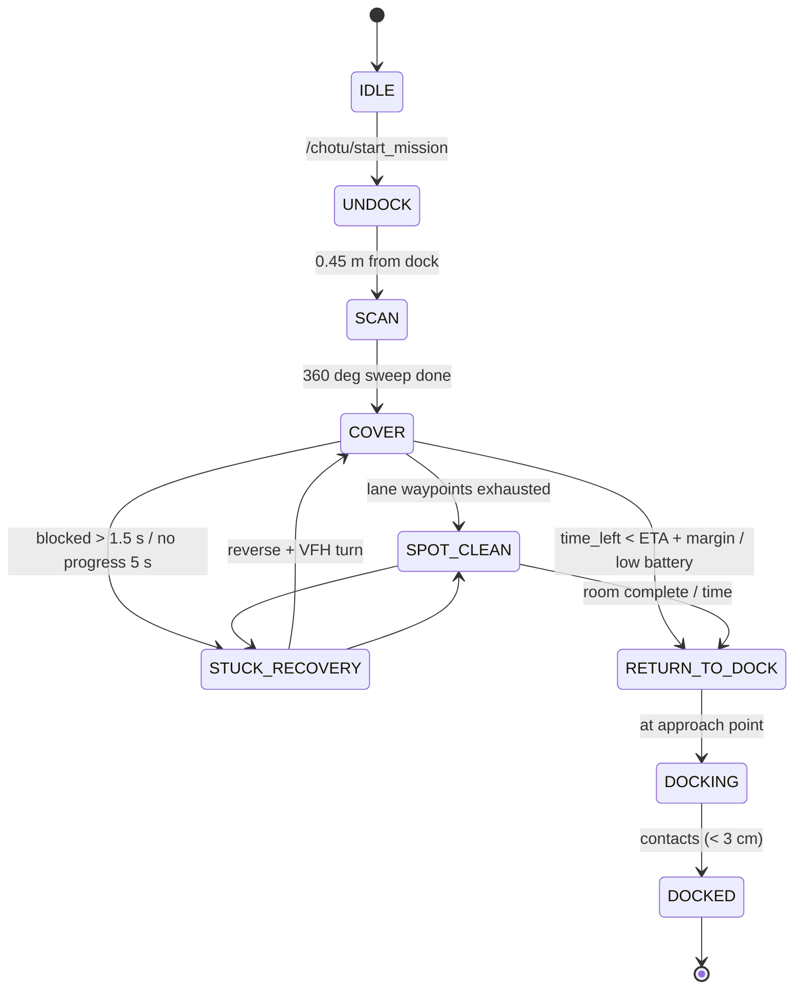

# CHOTU v2: System Architecture

## 1. Block diagram



## 2. Software layers

| Layer | Where | Rate | Code |
|---|---|---|---|
| Motor PWM, encoder ISR, wheel PID, ultrasonic ISR, safety watchdog | ESP32-S3 | 50 Hz (ISRs async) | `firmware/esp32s3_base_controller/src/main.cpp` |
| Wire protocol, PID, safety rules (host-testable) | ESP32-S3 + host g++ | – | `firmware/.../lib/chotu_logic/src/chotu_logic.h` |
| Serial bridge, odometry (encoder + gyro), TF, sensor topics | Pi 4 | 50 Hz | `ros2_ws/src/chotu_base` |
| Mission FSM, mapping, coverage, A*, reactive safety, adaptive suction | Pi 4 | 20 Hz | `chotu_core/*` via `chotu_navigation/mission_manager_node.py` |
| Suck/avoid detection + floor projection | Pi 4 (CPU, NCNN) / RTX 3060 (CUDA) | 5 FPS | `chotu_core/perception.py`, `chotu_perception` |
| Digital twin + HUD + fleet + benchmark | Workstation / CI / Docker | 20 Hz sim | `bot_simulation/` |
| Gazebo world (physics simulation) | Workstation (Docker) | 500 Hz physics | `chotu_gazebo`, `chotu_bringup/launch/sim.launch.py` |

## 3. Mission state machine



## 4. Autonomy algorithms (chotu_core)

* **Odometry** (`kinematics.py`). The encoders are single-channel, so direction comes from the command sign. Heading is fused with the MPU6050 gyro (complementary filter, 0.98 gyro). The gyro bias is calibrated on the dock at boot.
* **Mapping** (`occupancy_grid.py`). A 5 cm log-odds grid. HC-SR04 echoes are integrated over their **15° cone** (three rays). The cone edges carry weaker free-space evidence, so thin chair legs survive. Echoes explained by the **known room walls** are not mapped. The camera's *avoid* detections become permanent keep-out discs.
* **Coverage** (`coverage_planner.py`, `autonomy.py`). Boustrophedon lanes 22 cm apart give 2 cm of overlap for a 24 cm head. The next waypoint is picked greedily with an anisotropic cost (along-lane 1, lane change 2.5, reversing +0.6). That finishes the region the robot is in before crossing over, which works like an online cell decomposition. Leftover pockets are found with connected components (*frontier fill*).
* **Planning** (`path_planner.py`). 8-connected A* on a two-tier map: **hard** cells are physically impossible, **soft** cells are the clearance band. Soft cells are allowed only inside an *escape disc* around the robot, so it can always plan its way out but is never routed between chair legs. Paths are string-pulled for line of sight.
* **Reactive safety** (`obstacle_avoidance.py`). Every echo is projected onto the round chassis' swept corridor. A wall *beside* the robot no longer blocks it, but a chair leg *ahead* does. The firmware enforces the same stop rules independently.
* **Time-aware return.** Every second the robot plans an A* path home and estimates the ETA at 75 % of top speed. It leaves for the dock when `time_left < ETA + 14 s`.
* **Adaptive suction** (`suction_controller.py`). ECO is 55 % and BOOST is 100 % for 1.2 s after debris is detected ahead. Fan power scales with duty^1.5.

## 5. Pi ↔ ESP32 protocol

Each frame is `COBS(payload ‖ CRC16-CCITT) ‖ 0x00`, where the payload is `msg_id:u8, seq:u8, body` (little-endian).

| ID | Direction | Body |
|---|---|---|
| `0x01` CMD_VEL | Pi → ESP | `i16 v_mm_s, i16 w_mrad_s` |
| `0x02` ACTUATORS | Pi → ESP | `u8 suction_pct, u8 brush_pct` |
| `0x03` HEARTBEAT | Pi → ESP | – (feeds the 300 ms watchdog) |
| `0x04` ESTOP | Pi → ESP | `u8 engage` |
| `0x81` TELEMETRY | ESP → Pi | `u32 t_ms, i32 ticks_l, i32 ticks_r, i16 gyro_z_mrad_s, u16 us_l, us_c, us_r, tof (mm), u8 flags, u16 batt_mv` (25 B) |

The flag bits are bump (0), cliff L (1), cliff R (2), e-stop (3) and watchdog (4). Python (`chotu_core/protocol.py`) and C++ (`chotu_logic.h`) are tested against the **same byte vectors**.

## 6. ESP32-S3 DevKitC-1 pin map

| Function | GPIO | Notes |
|---|---|---|
| L298N ENA / IN1 / IN2 (left) | 4 / 5 / 6 | 20 kHz, 10-bit PWM |
| L298N ENB / IN3 / IN4 (right) | 7 / 15 / 16 | |
| Encoder L / R | 17 / 18 | LM393 slot sensor, 20 slots, **5 V → level shift** |
| I2C SDA / SCL | 8 / 9 | VL53L0X (0x29) + MPU6050 (0x68), 400 kHz |
| VL53L0X XSHUT | 47 | |
| HC-SR04 L trig/echo | 10 / 13 | **echo is 5 V → 1k/2k divider** |
| HC-SR04 C trig/echo | 11 / 14 | |
| HC-SR04 R trig/echo | 12 / 21 | |
| SW-420 bump | 38 | interrupt, rising edge |
| Cliff IR L / R | 39 / 40 | HIGH = no floor |
| Vacuum MOSFET / Brush MOSFET | 41 / 42 | IRLZ44N logic-level |
| Battery sense | 1 | 100 k / 22 k divider (ADC1) |
| Buzzer / status LED | 2 / 48 | |

We avoided strapping pins (0, 3, 45, 46), USB (19/20), flash and PSRAM (26–37) and UART0 (43/44, the Pi link). The XIAO ESP32-S3 Sense from the original spec sheet has only 11 GPIO, which is too few for this sensor set without an I/O expander. It remains an option for a **camera-only satellite** board.

## 7. ROS 2 graph

```
/camera/image_raw ─► yolo_detector_node ─► /chotu/detections ─┐
serial_bridge_node ─► /odom /imu /range/{left,center,right,tof} /chotu/bump /chotu/cliff /battery_state ─► mission_manager_node
mission_manager_node ─► /cmd_vel /chotu/actuators ─► serial_bridge_node ─► ESP32
mission_manager_node ─► /chotu/status /map /chotu/plan  (RViz, dashboards)
service: /chotu/start_mission (chotu_interfaces/srv/StartMission)
```

In Gazebo, `gz_sensor_adapter_node` replaces `serial_bridge_node` and publishes the **same topics**. The mission node does not know whether it is running in simulation or on hardware.
