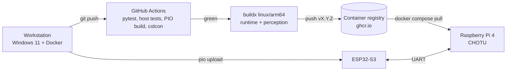

# Deployment Guide

> The prototype deploys to a single Raspberry Pi 4 robot. Production concerns are listed at the end and deliberately deferred: fleet management, OTA updates, signed images and enclosure certification.

## 1. Release artefacts

| Artefact | Built from | Runs on |
|---|---|---|
| `chotu/runtime:<ver>` (linux/arm64 + amd64) | `docker/Dockerfile --target runtime` | Raspberry Pi 4: serial bridge, mission manager, camera |
| `chotu/perception:<ver>` | `--target perception` | Pi 4 (CPU/NCNN) or a GPU workstation (`--gpus all`) |
| `chotu/dev:<ver>` | `--target dev` | Workstation: build, Gazebo, RViz |
| `chotu/twin:<ver>` | `docker/Dockerfile.sim` | CI / cloud: headless benchmarks and fleet studies |
| `firmware.bin` | `pio run -e esp32s3` | ESP32-S3 base controller |
| `chotu_suck_avoid_yolov8n_ncnn_model/` | `training/train_suck_avoid.py` | Mounted read-only at `/opt/chotu/models` |

Always tag images with a version (`CHOTU_VERSION=2.0.0`) and never deploy `:latest` to a robot. The 2026 Docker-for-ROS-2 guide makes the same point: it is what allows a confident rollback.

## 2. Pipeline



## 3. Step by step

### 3.1 Firmware
```bash
bash scripts/flash_esp32.sh /dev/ttyUSB0        # or COM5 on Windows
```
Record the firmware git hash next to the image version in the release notes. The protocol is versioned by message IDs, so bump an ID when you change a payload.

### 3.2 Container images (from the workstation)
```bash
export REGISTRY=ghcr.io/<github-user> PI_HOST=ubuntu@chotu.local
echo $GITHUB_TOKEN | docker login ghcr.io -u <github-user> --password-stdin
bash scripts/deploy_pi.sh 2.0.0
```
`deploy_pi.sh` does the following:
1. Builds `runtime` and `perception` for **linux/arm64** with buildx and pushes them.
2. Copies `docker-compose.yml` to the Pi.
3. Runs `docker compose --profile robot pull && up -d` on the Pi.

### 3.3 Model weights
```bash
scp -r models/chotu_suck_avoid_yolov8n_ncnn_model ubuntu@chotu.local:~/chotu/models/
```

### 3.4 Start on boot
The compose services use `restart: unless-stopped`, so the stack comes back after a power cycle. To start cleaning automatically, for competition mode, edit `chotu_params.yaml` so that `chotu_mission_manager.auto_start: true`. Alternatively, trigger it from a phone or laptop on the same network:
```bash
ros2 service call /chotu/start_mission chotu_interfaces/srv/StartMission "{abort: false, time_budget_s: 300.0}"
```

### 3.5 Verify on the robot
```bash
docker compose --profile robot ps
docker compose --profile robot logs -f robot          # "CHOTU mission manager ready"
docker exec -it chotu-robot-1 bash -lc "ros2 topic hz /odom"
```

### 3.6 Roll back
```bash
CHOTU_VERSION=1.9.0 docker compose --profile robot up -d     # previous tag
```

## 4. Debugging routine (from the Docker-for-ROS-2 guide)
Check each layer in this order before suspecting ROS code:
1. `docker ps`: is the container running?
2. `docker logs <c>`: did a process crash?
3. `docker exec -it <c> bash`: are the files, devices (`/dev/ttyUSB0`, `/dev/video0`) and models there?
4. Is ROS sourced? (`echo $ROS_DISTRO`, `ros2 pkg list | grep chotu`)
5. Is the cause networking (DDS domain, host network), hardware (wiring, power, watchdog flag) or display (`DISPLAY`, X11 socket)?

## 5. Competition-day checklist (AtomQuest finale format)
- [ ] Battery above 12.2 V, dust container emptied and latched
- [ ] Room size and dock position entered in `chotu_params.yaml`
- [ ] Robot placed on the dock and powered **still** (gyro calibration, two beeps)
- [ ] `ros2 topic echo /chotu/status --once` shows `IDLE`, battery state OK
- [ ] Use the 1-minute inspection to note low objects (cables), then trust the camera keep-outs
- [ ] Start the service call and the stopwatch together; keep the e-stop ready (`ros2 topic pub /chotu/estop std_msgs/Bool "{data: true}" --once`)

## 6. Deferred to production (intentionally not done yet)
* A molded enclosure, IP rating and EMC certification of the vacuum motor and drivers
* Signed images, secure boot and OTA (for example Mender or balena) with A/B partitions
* Fleet backend: multi-robot dashboard and map server, which the simulator's `--fleet` mode prototypes
* A custom PCB replacing the breadboard and modules
* LiDAR SLAM (`slam_toolbox`) for multi-room homes
