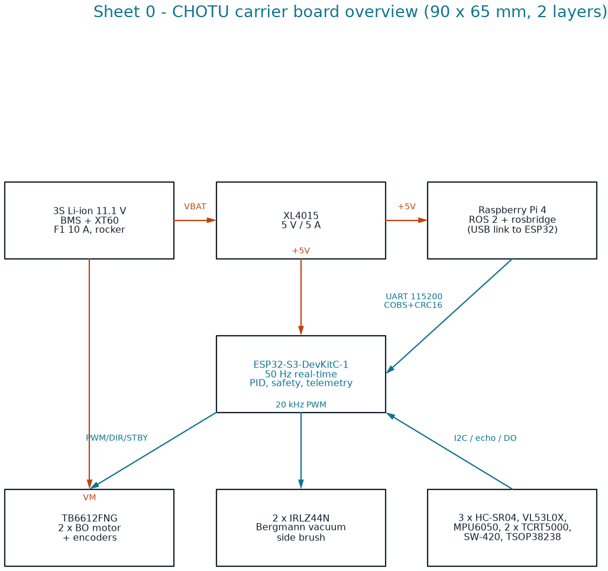

# CHOTU carrier PCB: firmware connection schematic

A 2-layer, 90 × 65 mm carrier board for the **ESP32-S3-DevKitC-1**. It replaces the breadboard and jumper wiring of the AtomQuest build (`essential_docs/Bot_circuit_diagram.jpg`, `bot_connection_schema.jpeg`). Every GPIO matches the firmware's `firmware/esp32s3_base_controller/include/pins.h`, and **`tests/test_pcb_netlist.py` fails if they ever differ.**

<p align="center"></p>

| Sheet | Contents |
|---|---|
| [00 overview](schematic/00_overview.png) | Battery → power → ESP32 ↔ Pi, drivers, sensors |
| [01 MCU pin map](schematic/01_mcu_pinmap.png) | Every ESP32-S3 GPIO and its net |
| [02 power](schematic/02_power.png) | XT60, 10 A fuse, switch, 470 µF bulk, XL4015 5 V / 5 A with 1000 µF, battery-sense divider 100 k / 22 k |
| [03 motor drive](schematic/03_motor_drive.png) | TB6612FNG with PWM/DIR, **STBY on GPIO2 with a 10 k pull-down** (motors off at boot), encoders through 1 k / 2 k dividers |
| [04 vacuum and brush drivers](schematic/04_vacuum_brush_drivers.png) | 2 × IRLZ44N low-side switches, 100 Ω gate, 10 k pull-down, **1N5822 flyback**, cathode to VBAT |
| [05 sensors](schematic/05_sensors.png) | 3 × HC-SR04 (echo dividers), I²C VL53L0X + MPU6050 (4.7 k pull-ups), SW-420, 2 × TCRT5000, TSOP38238 dock IR (100 Ω + 4.7 µF filter) |

Every sheet is also an SVG.

## Files

| File | What |
|---|---|
| `chotu_carrier.py` | **Single source of truth**: the header pin names, `GPIO` table, 54 parts with footprints, and net rules. It also runs a design-rule check. |
| `chotu_carrier.net` | KiCad netlist generated with SKiDL. Import it in KiCad (*File → Import → Netlist*) or in Protoflow. |
| `erc_report.txt` | Design-rule result: 54 parts, 45 nets, 0 errors. Every net has at least 2 pins, every firmware signal reaches its GPIO, and no strapping, flash or USB pin is used. |
| `render_schematic.py` | Draws the six sheets with schemdraw from the same tables |
| `protoflow/` | Hand-off package for layout in Protoflow (see its README) |

## Layout rules

* **Trace widths.** 2.0 mm for the battery, motor and vacuum nets (the vacuum peaks at about 5 A), 1.0 mm for +5V, 0.3 mm for signals.
* **Star ground.** Motor and vacuum returns join logic ground at one point next to the XT60. Pour GND on the bottom layer.
* **No copper under the ESP32 antenna.** Keep the MOSFETs and their flyback diodes on the opposite edge.
* **Decoupling.** C2 within 10 mm of the buck output; C1 within 10 mm of the XT60.
* **Mounting.** Four M3 holes, 4 mm from each corner. They match the printed electronics deck in `bot_3d_printing/`.
* **TB6612 VM** is on VBAT: 12.6 V at full charge, under the 13.5 V limit.

## Regenerate

```bash
pip install -r requirements-dev.txt         # skidl, schemdraw
python hardware/pcb/chotu_carrier.py        # netlist + erc_report.txt
python hardware/pcb/render_schematic.py     # schematic/*.png + *.svg
python -m pytest tests/test_pcb_netlist.py -q
```

SKiDL prints warnings about missing KiCad symbol libraries. They are expected: the parts are defined in code, so KiCad does not need to be installed.
