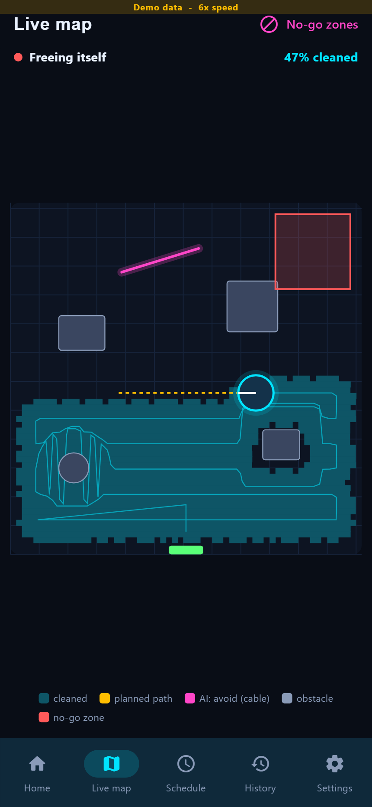

# CHOTU mobile app (Flutter)

Controls one CHOTU robot. It talks directly to the robot's **rosbridge** (`ws://<pi>:9090`) and, when configured, to the **fleet backend** (`backend/`) for history and schedules. It ships with a **demo robot**, so it can be used without any hardware; that is how it runs today.

<p align="center">
  
  
  
  
</p>

| Feature | Robot interface |
|---|---|
| Start cleaning / return to dock | `call_service /chotu/start_mission` (`abort` false / true) |
| Live status ring: state, coverage, battery, suction | `subscribe /chotu/status` |
| Live map with coverage, path, AI *avoid* lines, obstacles | `subscribe /map`, `/chotu/plan`, `/odom` |
| Draw no-go zones | `call_service /chotu/set_zones` (+ `PUT /api/v1/robots/{id}/zones` on the backend) |
| Alerts (bin full, brush tangle, stuck) | status events |
| Schedules, history, mission report with the AtomQuest rubric | local, or the backend with `BACKEND_URL` |

**Real robot:** [REAL_ROBOT_CONNECTION.md](REAL_ROBOT_CONNECTION.md) explains how to build, connect and control, and what is stored where. It was verified against the Gazebo robot's rosbridge.

## Code

```
chotu_app/lib/
├── main.dart, app_state.dart, theme.dart, keys.dart, tour.dart
├── models.dart                       RobotStatus, MapSnapshot, Zone, MissionReport, rubric weights
├── data/
│   ├── robot_repository.dart         interface used by every screen
│   ├── demo_robot_repository.dart    demo robot (same room as the Gazebo world)
│   ├── rosbridge_robot_repository.dart + rosbridge_protocol.dart   real robot
│   └── backend_api.dart              fleet backend REST client
├── screens/                          connect, home, map, schedule, history (+ report), alerts, settings
└── widgets/common.dart
```

## Run

```bash
cd mobile_app/chotu_app
flutter pub get
flutter run -d chrome                                                     # demo robot
flutter run -d chrome --dart-define=BACKEND_URL=http://127.0.0.1:8000     # + backend history/schedules
flutter build apk --release                                               # Android
flutter analyze && flutter test                                           # 11 tests
```

The screenshots and the full recording are in [`app_screenshot_screen_recording/`](app_screenshot_screen_recording/). `tools/record_app_demo.py` regenerates them.
