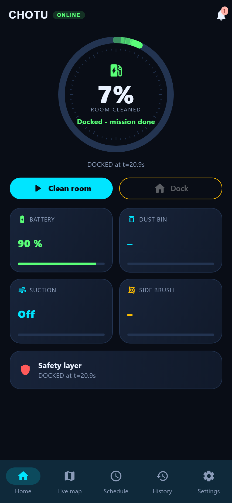
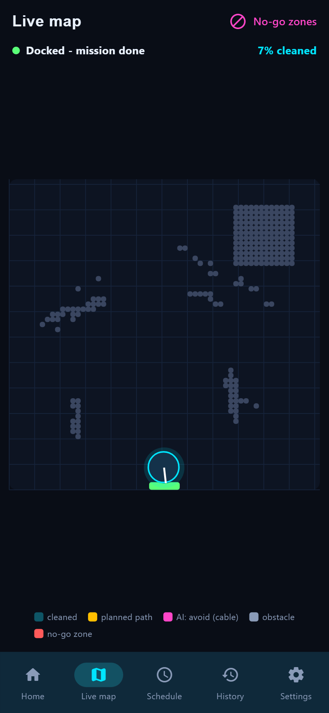

# Connecting the app to a real CHOTU robot

The app has three data sources. All three ship in the same build.

| Mode | Robot data from | History and schedules from | When |
|---|---|---|---|
| **Demo** | `DemoRobotRepository` (simulated, same room as Gazebo) | the app's memory | now: no hardware bought yet |
| **Direct** | the robot's rosbridge `ws://<robot>:9090` (`RosbridgeRobotRepository`) | the app's memory | one robot, phone on the same WiFi |
| **Direct + backend** | the robot's rosbridge | the fleet backend (`backend_api.dart`) | several robots or phones, history that survives reinstalls |

Live control **always goes straight to the robot**, never through the backend. If the backend or the internet is down, the robot can still be started, stopped and docked from the app. The robot-side setup (hardware, firmware, Docker on the Pi) is in [`backend/REAL_ROBOT_INTEGRATION.md`](../backend/REAL_ROBOT_INTEGRATION.md), Phases 1–5. This page covers the app.

## Verified against the Gazebo robot

The rehearsal used the same rosbridge, topics and services as the Raspberry Pi. *Connect by address* `ws://127.0.0.1:9090` showed live robot data:

<p align="center">
  
  
</p>

* **ONLINE** and **Docked: mission done** come from `/chotu/status`. The 90 % battery is the status's `battery_soc`.
* The map shows the robot's own occupancy grid (`/map`): the obstacles it sensed, its pose (`/odom`) on the dock, and its 7 % coverage, because the backend had sent it home early.
* **Dust bin** and **Side brush** show "–". The robot has no bin-level or brush-wear sensor, so the app does not invent a value. Only the demo robot fills them in.

## Step by step

### 1. Build the app

```bash
cd mobile_app/chotu_app
flutter pub get
flutter build apk --release                                    # Android phone
# with the fleet backend:
flutter build apk --release --dart-define=BACKEND_URL=https://fleet.example:8000 \
    --dart-define=BACKEND_KEY=<api key> --dart-define=ROBOT_ID=chotu-01
```
Install it with `flutter install` or by copying `build/app/outputs/flutter-apk/app-release.apk` to the phone.

**Network permissions.** These are already set, and they are what make release builds work:
* **Android:** `INTERNET` permission and `usesCleartextTraffic` in `android/app/src/main/AndroidManifest.xml`. The robot speaks plain `ws://` on the LAN.
* **iOS:** `NSLocalNetworkUsageDescription` and `NSAllowsLocalNetworking` in `ios/Runner/Info.plist`. iOS asks the user once for local-network access.

### 2. Put the phone and the robot on the same network
* Join the WiFi the robot uses (Phase 4 of the integration guide).
* Check from a laptop on that WiFi: `ping chotu-01.local`. If your network blocks mDNS, use the robot's reserved IP instead.

### 3. Connect
Open the app → **Connect by address** → enter `ws://chotu-01.local:9090` → **Connect**.

On connect, the app sends four rosbridge subscriptions. Each is throttled to keep the Pi's CPU free:

| Topic | Type | Throttle | Drives |
|---|---|---|---|
| `/chotu/status` | `chotu_interfaces/msg/CleaningStatus` | 200 ms | status ring, battery, suction, safety, alerts |
| `/odom` | `nav_msgs/msg/Odometry` | 100 ms | robot marker and trail |
| `/chotu/plan` | `nav_msgs/msg/Path` | 500 ms | planned path (yellow) |
| `/map` | `nav_msgs/msg/OccupancyGrid` | 1000 ms | obstacles on the live map |

**Expected:** the header shows **ONLINE**, the ring shows `IDLE` (or `DOCKED`), and the map draws within about 1 s.

### 4. Control

| Button | rosbridge message | Robot reaction |
|---|---|---|
| **Clean room** | `call_service /chotu/start_mission {abort: false}` | UNDOCK → SCAN → COVER … |
| **Dock** | `call_service /chotu/start_mission {abort: true}` | `CleaningMission.request_dock` → A* home → IR docking |
| **No-go zones → Apply** | `call_service /chotu/set_zones {no_go: [{x_min, y_min, x_max, y_max}]}` | keep-out cells; the mission manager logs `n no-go zone(s) set` |

With `BACKEND_URL` set, **Apply** also sends `PUT /api/v1/robots/{id}/zones`, so the zones are stored. After connecting, the app loads History and Schedules from `GET /api/v1/missions?robot_id=…` and `GET /api/v1/robots/{id}/schedules`. If the backend cannot be reached, an info alert appears and the app keeps working directly.

### 5. What is stored where

| Data | Stored |
|---|---|
| Live status, map, path | not stored by the app (current mission only) |
| No-go zones | on the robot for the session; in the backend database when `BACKEND_URL` is set |
| Schedules, mission history | app memory; in the backend database when `BACKEND_URL` is set |
| Long-term logs and telemetry history | robot-side rosbag and the backend `telemetry` table: designed in [`backend/REAL_ROBOT_INTEGRATION.md`](../backend/REAL_ROBOT_INTEGRATION.md) §9 |

## Troubleshooting

| Symptom | Fix |
|---|---|
| *Connection closed* immediately | Phone on another WiFi or on mobile data. Wrong host: try the IP. Is the robot container up? (`docker compose --profile robot ps`) |
| Works in debug, not in the release APK | Rebuild after `git pull`: older builds lacked the `INTERNET` permission in the main manifest |
| ONLINE but nothing moves on the map | `/odom` not publishing: check the ESP32 link (`ros2 topic hz /odom` on the Pi) |
| *Clean room* does nothing | The mission manager is not running, or it rejected the call (see the robot log). E-stop engaged? |
| Info alert *Backend unreachable* | Wrong `BACKEND_URL` or key. The app keeps working directly; only History and Schedules stay local. |
